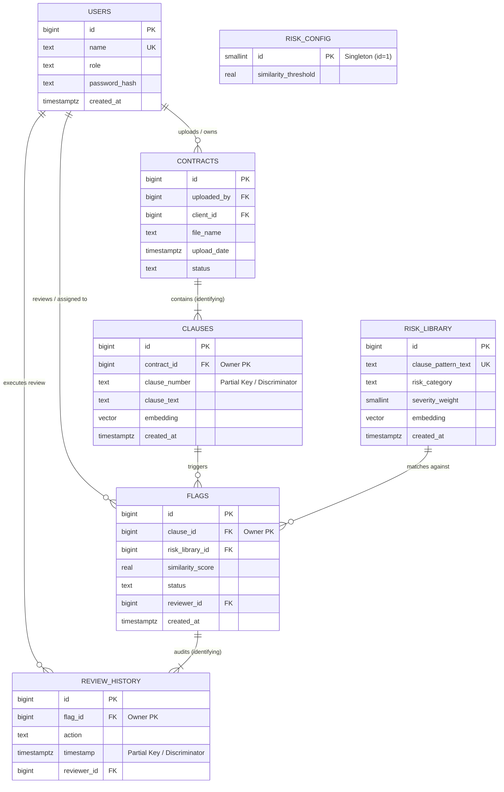

# ClauseGuard: Relational Schema & Entity Classification
## Academic Deliverable: Relational Schema, Strong Entities, and Weak Entities

---

### Project & Team Metadata
- **Project Title:** ClauseGuard — AI-Assisted Contract Clause Risk Flagging System
- **Course / Deliverable:** Database Management Systems (DBMS) Laboratory Deliverable
- **Team Members:**
  - **Tusti** (`PES1UG24CS505`) — Track A: Database, Vector Indexing & Embedding Pipeline Lead
  - **Ritu Ravish** (`PES1UG24CS928`) — Track B: Application Architecture, Reviewer Workflows & Auth Lead
- **Target DBMS:** PostgreSQL 15+ with `pgvector` (Dense 384-dimensional cosine vector space)
- **Schema Normalization Level:** Third Normal Form (3NF)

---

## 1. Complete Project Context

### 1.1 Problem Statement & Background
Commercial and legal agreements routinely contain predatory, ambiguous, or heavily one-sided terms—such as unlimited liability clauses, unilateral termination without notice, sweeping one-sided indemnification, predatory auto-renewal traps, and unconstrained fee escalations. 

For legal aid clinics, non-profits, public defenders, and small organizations, conducting exhaustive manual reviews on multi-page contracts is cost-prohibitive and time-intensive.

**ClauseGuard** is an automated contract clause triage system that combines a **relational SQL database (PostgreSQL)** with an **AI semantic vector database (`pgvector`)**. It ingests legal agreements, extracts discrete numbered clauses, converts each clause into a 384-dimensional dense semantic vector, and compares them against a curated library of predatory patterns using cosine similarity search. When a clause crosses a severity threshold, the system automatically creates review flags that human legal professionals inspect, triage, and record within ACID transactions.

```
+--------------------------------------------------------------------------------------------------+
|                                  ClauseGuard System Data Flow                                    |
+--------------------------------------------------------------------------------------------------+
                                                                                                    
 [Client] -------> Uploads Contract (PDF / Text)                                                   
                        |                                                                           
                        v                                                                           
             Text Extractor & Segmenter                                                             
                        |                                                                           
                        v                                                                           
             FastAPI Embedding Microservice (all-MiniLM-L6-v2)                                      
                        |                                                                           
                        v  (384-dimensional dense normalized vectors)                               
             PostgreSQL Relational DB + pgvector                                                    
               • Persists: contracts & clauses                                                      
               • Trigger: trg_flag_clause_when_risky fires on embedding INSERT                     
               • Matches: clauses <=> risk_library patterns (cosine distance)                       
               • Flags: creates 'Open' flags if similarity >= dynamic threshold                     
                        |                                                                           
                        v                                                                           
 [Reviewer Queue] <---> Atomic PostgreSQL TRANSACTION (UPDATE flags + INSERT review_history)        
                        |                                                                           
 [LegalAdmin] --------> CTE-backed Analytical View: unresolved_flags_by_client                      
```

### 1.2 System Actors and User Roles
1. **Client (`role = 'Client'`):**
   - Uploads contract documents (`contracts`).
   - Owns contract instances and views severity-highlighted clause breakdowns (`clauses`).
2. **Reviewer (`role = 'Reviewer'`):**
   - Accesses assigned triage queues (`flags`).
   - Inspects flagged clauses against matched risk patterns and similarity scores.
   - Executes atomic triage actions (`Cleared` or `Escalated`) recorded into the immutable audit trail (`review_history`).
3. **LegalAdmin (`role = 'LegalAdmin'`):**
   - Manages user accounts and assigns open flags to designated reviewers.
   - Monitors portfolio-level risk metrics using the CTE view (`unresolved_flags_by_client`).
   - Dynamically tunes the system-wide similarity threshold (`risk_config`).
   - Maintains and curates reference predatory clause patterns (`risk_library`).

---

## 2. Entity-Relationship (ER) Model

The database comprises **seven entities** designed to model the contract analysis and triage lifecycle in compliance with 3NF.



---

## 3. Relational Schema Specification

### 3.1 Formal Relational Notation
In relational algebra and database design notation:
- Primary key attributes are **<u>underlined</u>**.
- Foreign key attributes are denoted with **italics** and superscript reference $\text{FK}$.

1. $\text{USERS}(\underline{\text{id}}, \text{name}, \text{role}, \text{password\_hash}, \text{created\_at})$
2. $\text{CONTRACTS}(\underline{\text{id}}, \textit{uploaded\_by}^{\text{FK}}, \textit{client\_id}^{\text{FK}}, \text{file\_name}, \text{upload\_date}, \text{status})$
3. $\text{CLAUSES}(\underline{\text{id}}, \textit{contract\_id}^{\text{FK}}, \text{clause\_number}, \text{clause\_text}, \text{embedding}, \text{created\_at})$
   - *Natural Candidate Key:* $(\textit{contract\_id}, \text{clause\_number})$
4. $\text{RISK\_LIBRARY}(\underline{\text{id}}, \text{clause\_pattern\_text}, \text{risk\_category}, \text{severity\_weight}, \text{embedding}, \text{created\_at})$
5. $\text{FLAGS}(\underline{\text{id}}, \textit{clause\_id}^{\text{FK}}, \textit{risk\_library\_id}^{\text{FK}}, \text{similarity\_score}, \text{status}, \textit{reviewer\_id}^{\text{FK}}, \text{created\_at})$
   - *Active Conflict Candidate Key:* $(\textit{clause\_id}, \textit{risk\_library\_id}) \text{ WHERE status} = \text{'Open'}$
6. $\text{REVIEW\_HISTORY}(\underline{\text{id}}, \textit{flag\_id}^{\text{FK}}, \text{action}, \text{timestamp}, \textit{reviewer\_id}^{\text{FK}})$
7. $\text{RISK\_CONFIG}(\underline{\text{id}}, \text{similarity\_threshold})$

---

### 3.2 Relational Data Dictionary & Integrity Constraints

| Relation Name | Attribute | Data Type | Key Type | Nullable | Integrity Constraints & Descriptions |
|---|---|---|---|---|---|
| **users** | `id` | `BIGINT` | **PK** | No | `GENERATED ALWAYS AS IDENTITY` |
| | `name` | `TEXT` | **Candidate Key** | No | `UNIQUE`, login username / identifier |
| | `role` | `TEXT` | Attribute | No | `CHECK (role IN ('Client', 'Reviewer', 'LegalAdmin'))` |
| | `password_hash` | `TEXT` | Attribute | No | bcrypt-hashed password (cost factor $\ge 10$) |
| | `created_at` | `TIMESTAMPTZ` | Attribute | No | `DEFAULT NOW()` |
| **contracts** | `id` | `BIGINT` | **PK** | No | `GENERATED ALWAYS AS IDENTITY` |
| | `uploaded_by` | `BIGINT` | **FK** | No | `REFERENCES users(id)` (uploader) |
| | `client_id` | `BIGINT` | **FK** | No | `REFERENCES users(id)` (owning client) |
| | `file_name` | `TEXT` | Attribute | Yes | Original document name |
| | `upload_date` | `TIMESTAMPTZ` | Attribute | No | `DEFAULT NOW()` |
| | `status` | `TEXT` | Attribute | No | `DEFAULT 'Processing'`, `CHECK (status IN ('Processing', 'Analyzed', 'Failed'))` |
| **clauses** | `id` | `BIGINT` | **PK** | No | `GENERATED ALWAYS AS IDENTITY` |
| | `contract_id` | `BIGINT` | **FK / Composite Key** | No | `REFERENCES contracts(id) ON DELETE CASCADE` |
| | `clause_number` | `TEXT` | **Discriminator** | No | `UNIQUE (contract_id, clause_number)` |
| | `clause_text` | `TEXT` | Attribute | No | `CHECK (BTRIM(clause_text) <> '')` |
| | `embedding` | `VECTOR(384)` | Attribute | Yes | Normalized vector for cosine distance |
| | `created_at` | `TIMESTAMPTZ` | Attribute | No | `DEFAULT NOW()` |
| **risk_library** | `id` | `BIGINT` | **PK** | No | `GENERATED ALWAYS AS IDENTITY` |
| | `clause_pattern_text`| `TEXT` | **Candidate Key** | No | `UNIQUE`, `CHECK (BTRIM(clause_pattern_text) <> '')` |
| | `risk_category` | `TEXT` | Attribute | No | Classification category (e.g., 'Unlimited Liability') |
| | `severity_weight` | `SMALLINT` | Attribute | No | `CHECK (severity_weight BETWEEN 1 AND 5)` |
| | `embedding` | `VECTOR(384)` | Attribute | Yes | 384-dimensional vector embedding |
| | `created_at` | `TIMESTAMPTZ` | Attribute | No | `DEFAULT NOW()` |
| **flags** | `id` | `BIGINT` | **PK** | No | `GENERATED ALWAYS AS IDENTITY` |
| | `clause_id` | `BIGINT` | **FK** | No | `REFERENCES clauses(id) ON DELETE CASCADE` |
| | `risk_library_id` | `BIGINT` | **FK** | No | `REFERENCES risk_library(id)` |
| | `similarity_score` | `REAL` | Attribute | No | `CHECK (similarity_score BETWEEN -1 AND 1)` |
| | `status` | `TEXT` | Attribute | No | `DEFAULT 'Open'`, `CHECK (status IN ('Open', 'Cleared', 'Escalated'))` |
| | `reviewer_id` | `BIGINT` | **FK** | Yes | `REFERENCES users(id)` (assigned legal reviewer) |
| | `created_at` | `TIMESTAMPTZ` | Attribute | No | `DEFAULT NOW()` |
| **review_history**| `id` | `BIGINT` | **PK** | No | `GENERATED ALWAYS AS IDENTITY` |
| | `flag_id` | `BIGINT` | **FK** | No | `REFERENCES flags(id) ON DELETE CASCADE` |
| | `action` | `TEXT` | Attribute | No | `CHECK (action IN ('Cleared', 'Escalated'))` |
| | `timestamp` | `TIMESTAMPTZ` | Attribute | No | `DEFAULT NOW()` |
| | `reviewer_id` | `BIGINT` | **FK** | No | `REFERENCES users(id)` |
| **risk_config** | `id` | `SMALLINT` | **PK** | No | Singleton locked to `1` via `CHECK (id = 1)` |
| | `similarity_threshold`| `REAL` | Attribute | No | `DEFAULT 0.75`, `CHECK (similarity_threshold > 0 AND similarity_threshold <= 1)` |

---

## 4. Strong Entity Types

### 4.1 Theoretical Definition of Strong Entities
In relational database theory and Extended Entity-Relationship (EER) modeling:
- A **Strong Entity Type** (also referred to as a **Regular Entity Type**) possesses its own intrinsic key attribute(s) that uniquely identify each entity occurrence without relying on foreign keys from other entities.
- Strong entities have **independent existence**: they do not depend on the presence of an owner entity for their identification or lifecycle.
- In ER diagrams, strong entities are represented by a **single rectangle**, and their primary keys are underlined with a solid line.
- When an associated entity is deleted, strong entities are **not** automatically destroyed.

---

### 4.2 Strong Entities in ClauseGuard

#### 1. `USERS`
- **Primary Key:** `id` (identity generated)
- **Natural Candidate Key:** `name` (enforced via unique constraint)
- **Why it is a Strong Entity:**
  - A user exists independently in the system. A client, reviewer, or legal administrator does not require any contract, clause, or flag to exist.
  - User accounts have an autonomous lifecycle: they can be registered, authenticated, and assigned permissions prior to any contract uploads or flag reviews.
  - No foreign key is required to establish the primary identity of a user.

#### 2. `RISK_LIBRARY`
- **Primary Key:** `id` (identity generated)
- **Natural Candidate Key:** `clause_pattern_text` (unique catalog text)
- **Why it is a Strong Entity:**
  - The risk library represents curated, domain-specific legal reference patterns (e.g., statutory benchmarks for predatory liability or unilateral termination).
  - Its records are established independently by legal administrators and exist permanently, whether or not any client uploads a contract matching them.
  - It maintains complete existence independence; deleting all contracts or clauses in the system leaves the `risk_library` unaffected.

#### 3. `RISK_CONFIG`
- **Primary Key:** `id` (locked singleton value `1`)
- **Why it is a Strong Entity:**
  - `risk_config` is an autonomous system-wide configuration entity storing operational parameters (the global cosine similarity trigger threshold).
  - It has no parent or identifying owner and operates as an independent configuration record.

#### 4. `CONTRACTS`
- **Primary Key:** `id` (identity generated)
- **Relationship Context:** Associated with `USERS` through `uploaded_by` and `client_id`.
- **Why it is a Strong Entity:**
  - While a contract has relationships with users (`uploaded_by` and `client_id`), it is a **strong entity** in relational modeling.
  - A contract possesses an independent primary key (`id`) and represents an autonomous business document with its own state lifecycle (`Processing` $\rightarrow$ `Analyzed` $\rightarrow$ `Failed`).
  - It does not borrow its key from `USERS` to establish its uniqueness (i.e., its identity is not `(client_id, contract_sequence_number)`). A contract can persist as an archived document record even if the uploader's active session changes.

---

## 5. Weak Entity Types

### 5.1 Theoretical Definition of Weak Entities
In relational database theory:
- A **Weak Entity Type** does **not** have sufficient key attributes of its own to form a primary key.
- It is **existence-dependent** on an **identifying entity type** (also called the **owner entity**).
- A weak entity has a **partial key** (also called a **discriminator**), which is an attribute or set of attributes that uniquely distinguishes weak entity occurrences *only among those associated with the same owner entity*.
- The complete primary key of a weak entity is logically formed by the combination of:
  $$\text{Primary Key of Weak Entity} = \text{Primary Key of Identifying Entity} + \text{Partial Key (Discriminator)}$$
- The relationship linking the weak entity to its owner is called an **identifying relationship**, represented by a **double diamond** in ER diagrams, while the weak entity itself is represented by a **double rectangle**.
- In relational schema implementations, weak entities enforce total participation using `NOT NULL` on the owner's foreign key and enforce lifecycle dependency via **`ON DELETE CASCADE`**.

---

### 5.2 Weak Entities in ClauseGuard

#### 1. `CLAUSES` (Classic Weak Entity)
- **Identifying (Owner) Entity:** `CONTRACTS`
- **Identifying Relationship:** `CONTAINS` (A contract contains multiple clauses)
- **Partial Key / Discriminator:** `clause_number` (e.g., `'1.0'`, `'2.1'`, `'8.3'`)
- **Logical Composite Primary Key:**
  $$\text{PK}(\text{CLAUSES}) = (\text{contract\_id}, \text{clause\_number})$$
- **Relational Implementation:**
  - In physical implementation, an artificial surrogate key `id BIGINT GENERATED ALWAYS AS IDENTITY` is provided for fast join indexing.
  - However, the relational integrity strictly implements the weak entity definition via:
    ```sql
    contract_id BIGINT NOT NULL REFERENCES contracts(id) ON DELETE CASCADE,
    CONSTRAINT uq_clauses_contract_clause_number UNIQUE (contract_id, clause_number)
    ```
- **Why it is a Weak Entity:**
  1. **Absence of Autonomous Identity:** A `clause_number` like `'2.1'` or `'Section 4'` has no unique meaning on its own in the database; it only gains identity when qualified by its parent `contract_id`.
  2. **Existence Dependency:** A clause cannot exist without the contract from which it was extracted.
  3. **Cascading Lifecycle:** If a contract is deleted from the system, all of its constituent clauses are automatically deleted (`ON DELETE CASCADE`).

---

#### 2. `FLAGS` (Associative Weak Entity / Dependent Intersection)
- **Identifying (Owner) Entity:** `CLAUSES` (Primary Owner) and `RISK_LIBRARY` (Associated Reference)
- **Identifying Relationship:** `MATCHES_RISK` / `FLAGGED_ON`
- **Partial Key / Discriminator:** `risk_library_id` (within an active review state)
- **Logical Key:**
  $$\text{PK}(\text{FLAGS}) = (\text{clause\_id}, \text{risk\_library\_id}) \text{ WHERE status} = \text{'Open'}$$
- **Relational Implementation:**
  - Enforced via partial unique index:
    ```sql
    clause_id BIGINT NOT NULL REFERENCES clauses(id) ON DELETE CASCADE,
    risk_library_id BIGINT NOT NULL REFERENCES risk_library(id),
    CREATE UNIQUE INDEX uq_flags_open_clause_pattern 
        ON flags (clause_id, risk_library_id) WHERE status = 'Open';
    ```
- **Why it is a Weak Entity:**
  1. **Strict Existence Dependency:** A risk flag cannot exist without the specific extracted clause that triggered it.
  2. **Dependent Lifecycle:** If the parent clause (or its parent contract) is deleted, the flag ceases to have any meaning and is purged via `ON DELETE CASCADE`.
  3. **Associative Nature:** It exists exclusively to record the evaluation result between an extracted clause and a risk pattern.

---

#### 3. `REVIEW_HISTORY` (Dependent Audit Weak Entity)
- **Identifying (Owner) Entity:** `FLAGS`
- **Identifying Relationship:** `AUDITS` / `RECORDS_ACTION`
- **Partial Key / Discriminator:** `timestamp` (the sequential moment a review action occurred on that flag)
- **Logical Composite Key:**
  $$\text{PK}(\text{REVIEW\_HISTORY}) = (\text{flag\_id}, \text{timestamp})$$
- **Relational Implementation:**
  ```sql
  flag_id BIGINT NOT NULL REFERENCES flags(id) ON DELETE CASCADE,
  reviewer_id BIGINT NOT NULL REFERENCES users(id),
  "timestamp" TIMESTAMPTZ NOT NULL DEFAULT NOW()
  ```
- **Why it is a Weak Entity:**
  1. **Historical Dependency:** An entry in `review_history` represents an immutable audit log entry recording a reviewer's decision on a specific flag. It has no independent existence outside the flag it documents.
  2. **Cascading Purge:** If the flag being audited is deleted from the database, its dependent audit log entries are cascaded (`ON DELETE CASCADE`).

---

## 6. Strong vs. Weak Entity Comparison Matrix

| Property | Strong Entities (`USERS`, `RISK_LIBRARY`, `RISK_CONFIG`, `CONTRACTS`) | Weak Entities (`CLAUSES`, `FLAGS`, `REVIEW_HISTORY`) |
|---|---|---|
| **Primary Key Formation** | Has a complete, independent primary key from its own attributes. | Requires the primary key of its identifying owner entity plus a local discriminator. |
| **Existence Dependency** | Independent. Can exist without child records or external owners. | Dependent. Cannot exist without the prior existence of the identifying parent entity. |
| **Partial Key (Discriminator)** | None needed. | **Required:**<br>• `CLAUSES`: `clause_number`<br>• `FLAGS`: `risk_library_id` (open state)<br>• `REVIEW_HISTORY`: `timestamp` |
| **Referential Action on Delete** | Deletion of strong entity causes cascading deletion of dependent children. | Child records are purged when the parent is deleted (`ON DELETE CASCADE`). |
| **ER Diagram Representation** | Single rectangle $\square$ | Double rectangle $\begin{array}{|c|}\hline \square \\ \hline\end{array}$ |
| **Identifying Relationship** | Regular relationship (Single diamond $\lozenge$). | Identifying relationship (Double diamond). |
| **Foreign Key Nullability** | Can be standalone without foreign keys (or optional associations). | Foreign key referencing owner is strictly `NOT NULL`. |

---

## 7. Third Normal Form (3NF) Justification

The relational design enforces **Third Normal Form (3NF)** across all entities:

1. **First Normal Form (1NF):**
   - Every attribute contains only atomic, indivisible values.
   - Repeating groups (such as multiple clauses per contract or multiple flags per clause) are decoupled into distinct relations (`contracts` $\rightarrow$ `clauses` $\rightarrow$ `flags`).
2. **Second Normal Form (2NF):**
   - The schema is in 1NF and contains **no partial key dependencies**.
   - In weak entities with composite candidate keys (e.g., `clauses` with `(contract_id, clause_number)`), non-key attributes (`clause_text`, `embedding`) depend on the *entire* candidate key, not on a subset of it.
3. **Third Normal Form (3NF):**
   - The schema is in 2NF and contains **no transitive functional dependencies**.
   - Reviewer names are not duplicated in `flags` or `review_history`; only `reviewer_id` is stored, referencing `users(id)`.
   - Risk category and severity weight are not duplicated in `flags`; only `risk_library_id` is referenced.
   - Client details are not duplicated in `contracts`; only `client_id` is referenced.

---

## 8. Summary Checklist for Mentors

- [x] **Context of the Project:** Detailed explanation of ClauseGuard, problem statement, dual-database architecture, and actors.
- [x] **Full Relational Schema:** Formal relational notation, complete data dictionary, data types, nullability, primary keys, foreign keys, and CHECK constraints.
- [x] **Strong Entities Identified Separately:** Comprehensive breakdown of `USERS`, `RISK_LIBRARY`, `RISK_CONFIG`, and `CONTRACTS` with theoretical justification.
- [x] **Weak Entities Identified Separately:** Rigorous analysis of `CLAUSES`, `FLAGS`, and `REVIEW_HISTORY` detailing identifying entities, discriminators (partial keys), and `ON DELETE CASCADE` mechanics.
- [x] **Entity-Relationship Diagram:** Mermaid diagram visually representing entities, relationships, and cardinalities.
- [x] **Normalization:** Proof of 1NF, 2NF, and 3NF compliance.

