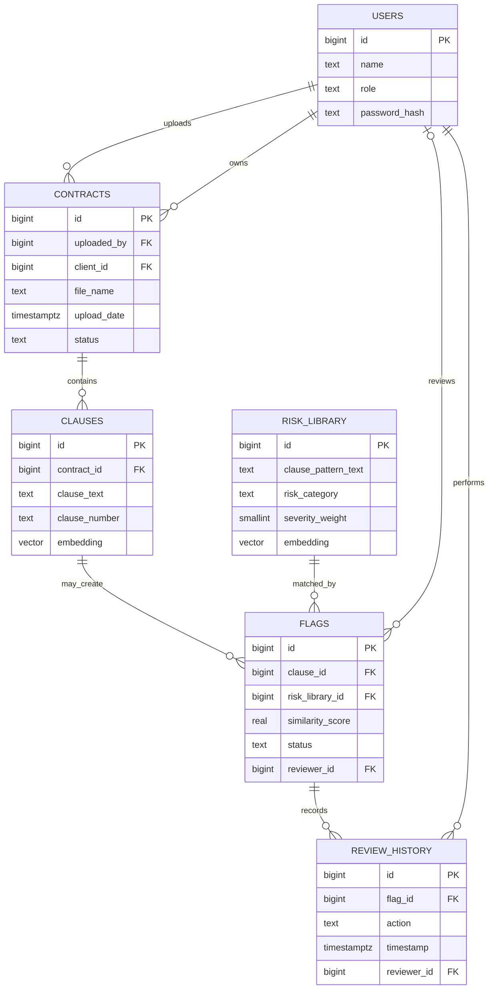

# Track A Handoff

This is the database and embedding contract for Track B. Apply `database/schema.sql` to a PostgreSQL database with pgvector available, then install the Python dependencies and seed the risk library as described below.

## Relational schema



The relational schema is: `users(id, name, role, password_hash, created_at)`; `contracts(id, uploaded_by, client_id, file_name, upload_date, status)`; `clauses(id, contract_id, clause_text, clause_number, embedding, created_at)`; `risk_library(id, clause_pattern_text, risk_category, severity_weight, embedding, created_at)`; `flags(id, clause_id, risk_library_id, similarity_score, status, reviewer_id, created_at)`; `review_history(id, flag_id, action, timestamp, reviewer_id)`; `risk_config(id, similarity_threshold)`.

Roles are `Client`, `Reviewer`, and `LegalAdmin`. Contract statuses are `Processing`, `Analyzed`, and `Failed`. Flag statuses are `Open`, `Cleared`, and `Escalated`; review actions are `Cleared` and `Escalated`. Each clause and risk pattern has a 384-dimensional embedding. IDs are generated by PostgreSQL identity columns.

## Database setup

1. Create a PostgreSQL database with pgvector installed/available on the server.
2. Set `DATABASE_URL` in the shell or local environment; do not commit credentials.
3. Apply `database/schema.sql` with `psql $env:DATABASE_URL -f database/schema.sql` in PowerShell, or use an equivalent SQL client.
4. If the database already has these tables, review the SQL before applying it: the schema uses `CREATE TABLE IF NOT EXISTS` and is an initial setup script, not a migration framework.

The initial HNSW indexes need a pgvector build with HNSW support. On an older pgvector build that rejects the index syntax, upgrade pgvector or temporarily remove those two index statements; vector query functionality does not depend on the indexes.

## Embedding and segmentation service

From the repository root:

```powershell
py -m venv .venv
.\.venv\Scripts\Activate.ps1
pip install -r embedding_service/requirements.txt
uvicorn embedding_service.app:app --host 127.0.0.1 --port 8001
```

The model downloads on first startup and is loaded once into the service process. It runs locally for inference; no embedding API key or model training is used.

### `POST /process-contract`

Request JSON:

```json
{"text":"1. Term. The agreement begins on the effective date.\n\n2. Renewal. It renews automatically unless notice is given."}
```

Response JSON shape:

```json
{
  "model": "sentence-transformers/all-MiniLM-L6-v2",
  "dimension": 384,
  "clauses": [
    {"clause_number":"1.","clause_text":"1. Term. The agreement begins on the effective date.","embedding":[0.01, -0.02]},
    {"clause_number":"2.","clause_text":"2. Renewal. It renews automatically unless notice is given.","embedding":[0.03, 0.04]}
  ]
}
```

The two shown vector values are abbreviated for readability; each returned embedding contains exactly 384 numbers. Numbered sections are split at heading lines. If none are found, non-empty paragraphs separated by blank lines become clauses. Any leading text before the first numbered heading is returned as `Preamble`. The route rejects empty text and accepts up to 2,000,000 characters.

### `POST /embed`

Request JSON: `{"texts":["First clause text","Second clause text"]}`. Response has `model`, `dimension: 384`, and an `embeddings` array in matching order. Each vector is normalized and contains 384 numbers. Batches contain 1–128 non-empty strings.

### `GET /health`

Returns service status, model name, and whether the model is loaded. The service does not connect to PostgreSQL; the Next.js application persists returned embeddings.

## Risk library seed

After applying the schema and setting `DATABASE_URL`, run:

```powershell
python -m embedding_service.seed_risk_library
```

The seed contains 25 illustrative patterns across five risk categories. It can be rerun safely: existing patterns are updated by their unique text, including their embedding. These examples are educational and do not constitute legal advice or a production legal reference set.

## SQL interfaces

### Similarity matches

```sql
SELECT * FROM find_similar_risks(:clause_id, 5);
```

Returns `risk_library_id`, `risk_category`, `severity_weight`, and `similarity_score`, ordered by cosine distance ascending. Similarity is `1 - cosine_distance`; larger is closer. A clause without an embedding, or an empty embedded library, returns no rows.

### Composite risk score

```sql
SELECT calculate_risk_score(:clause_id);
```

Returns `max(similarity_score, 0) * severity_weight / 5 * 100` for the best match, rounded to two decimals on a 0–100 scale. It returns `NULL` when there is no match. This is a triage score, not a legal judgment.

### Automatic flagging

`trg_flag_clause_when_risky` runs after a clause insert or embedding update. It compares the clause against embedded risk patterns and inserts one `Open` flag for the best match when similarity meets `risk_config.similarity_threshold` (default `0.75`). The threshold can be changed with:

```sql
UPDATE risk_config SET similarity_threshold = 0.78 WHERE id = 1;
```

Only the best matching pattern is considered per clause write. A partial unique index prevents duplicate open flags for the same clause and pattern. Cleared/escalated history remains intact; reprocessing can create a new open flag if it again meets threshold.

## Track B integration notes

- Create the contract row before inserting its clause rows. Store each returned vector in `clauses.embedding`; the insert trigger evaluates it immediately.
- Use parameterized SQL and pgvector's driver adapter when passing vectors. Do not create flags in the application; read the rows created by the trigger.
- Assign a reviewer to a flag through `flags.reviewer_id`. Track B owns authorization and the atomic flag-status plus `review_history` operation.
- Track B owns the CTE-backed `unresolved_flags_by_client` view. It should use `contracts.client_id`, `flags.similarity_score`, and the chosen unresolved statuses.
- The HNSW cosine indexes are included for the required indexing demonstration. Similarity lookup orders the risk library by distance to one clause vector, which is the shape pgvector can accelerate with its risk-library HNSW index. The clause index supports the reverse lookup shape. The hand-curated library is small, so an index may not improve observed speed; HNSW trades build/memory cost for approximate nearest-neighbor search. For tiny datasets, exact results may be preferable.

## Known design boundaries

- PDF text extraction belongs to the Next.js upload flow; this service accepts extracted text.
- The seed patterns and similarity threshold need demonstration/tuning with sample contracts. Similarity alone does not establish that a clause is legally risky.
- The database schema is an initial project schema. If Track B has already created compatible migrations or code, reconcile them with this contract before applying it.
